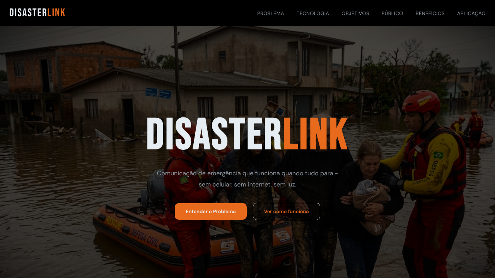

<div align="center">

# 🚨 DisasterLink · Landing Page

**A página que apresenta o problema da comunicação nos desastres, a solução e quem ela ajuda**


<sub>Front-End Design · Global Solution 2026.1 · Space Connect · FIAP</sub>



</div>

---

## Sobre o projeto

Quando uma enchente, um desabamento ou um incêndio acontece, a comunicação costuma cair junto: sem sinal de celular, sem internet e, muitas vezes, sem luz. As vítimas não conseguem pedir socorro, as equipes de resgate não sabem para onde ir e a Defesa Civil coordena as ações às cegas. Foi o que aconteceu no Rio Grande do Sul em 2024, quando municípios inteiros ficaram dias sem comunicação.

O **DisasterLink** nasceu para manter esse canal aberto. A solução completa reúne um **kit de emergência portátil**, uma central de comando para a Defesa Civil e um aplicativo para as equipes de resgate. O kit recebe os pedidos de socorro das vítimas por rádio LoRa e envia as informações pela rede 4G ou, quando ela falha, pelo satélite Iridium. Assim, a comunicação funciona em qualquer lugar do planeta, sem depender da infraestrutura terrestre.

Este repositório traz a **landing page** do DisasterLink, feita só com HTML e CSS. Ela apresenta a solução para quem nunca ouviu falar dela: o problema da comunicação nos desastres, como o kit funciona, quem é beneficiado e o caminho completo do pedido de socorro até o resgate. O layout se adapta ao celular, ao tablet e ao computador.

O objetivo é simples: que nenhum pedido de socorro se perca quando a comunicação cai, e que o resgate chegue primeiro a quem mais precisa.

---

## Seções da página

| Seção | O que mostra |
|---|---|
| **Início** | O slogan da solução, uma imagem de impacto e os botões de navegação |
| **Problema** | Como a comunicação cai nos desastres, com o caso do Rio Grande do Sul em 2024 |
| **Tecnologia** | Os módulos do kit de emergência, em cards |
| **Objetivos** | As metas da solução, em cards numerados |
| **Público-alvo** | Quem a solução ajuda diretamente |
| **Benefícios** | As principais vantagens do DisasterLink |
| **Aplicação** | O caminho completo do desastre até o resgate, em 5 etapas |

---

## Como executar

### Pelo terminal

```bash
# Clone o repositório
git clone https://github.com/SpaceConnect-DisasterLink/landing-page.git

# Entre na pasta
cd landing-page
```

Depois, abra o arquivo `index.html` no navegador (é só dar dois cliques nele).

<details>
<summary><b>Pelo VS Code</b></summary>

1. Abra o VS Code e clique em **File > Open Folder**
2. Selecione a pasta do projeto (landing-page)
3. Instale a extensão **Live Server**
4. Clique com o botão direito no `index.html` e escolha **Open with Live Server**

</details>

---

## Estrutura

```
landing-page/
├── index.html        ← Estrutura da página
├── css/
│   └── style.css     ← Estilos, variáveis e responsividade
├── images/
│   ├── hero.jpeg     ← Imagem da seção inicial
│   ├── problema.jpeg ← Imagem da seção Problema
│   ├── publico.jpeg  ← Imagem da seção Público-alvo
│   └── logo.png      ← Logo do DisasterLink
├── docs/             ← Imagem deste README
└── README.md         ← Este arquivo
```

---

## Limitações desta versão

A landing page é um **protótipo acadêmico**. Nesta versão:

- A página é só informativa, sem interação com o kit ou com a central de comando.
- Não há JavaScript. As partes interativas (slideshow, quiz, formulário e temas) estão no repositório [site-interativo](https://github.com/SpaceConnect-DisasterLink/site-interativo).

## Tecnologias utilizadas

- **HTML5:** estrutura e marcação semântica.
- **CSS3:** estilização, variáveis, Flexbox e responsividade.
- **Google Fonts:** Bebas Neue nos títulos e DM Sans no texto.

## Equipe

| Nome | RM |
|---|---|
| Caique Kenji Yafuco | 570368 |
| Guilherme Tomé Nogueira | 570144 |
| Lucas de Andrade Astorini | 569119 |
| Sabrina Lopes da Silva | 571870 |
| Sofia Satomi Hagio | 569120 |
